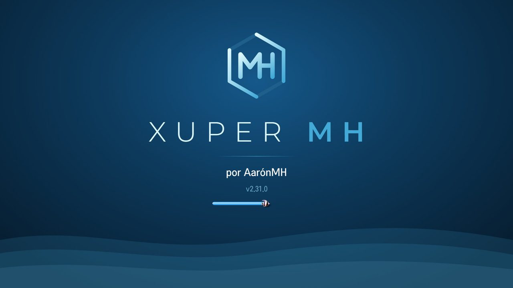
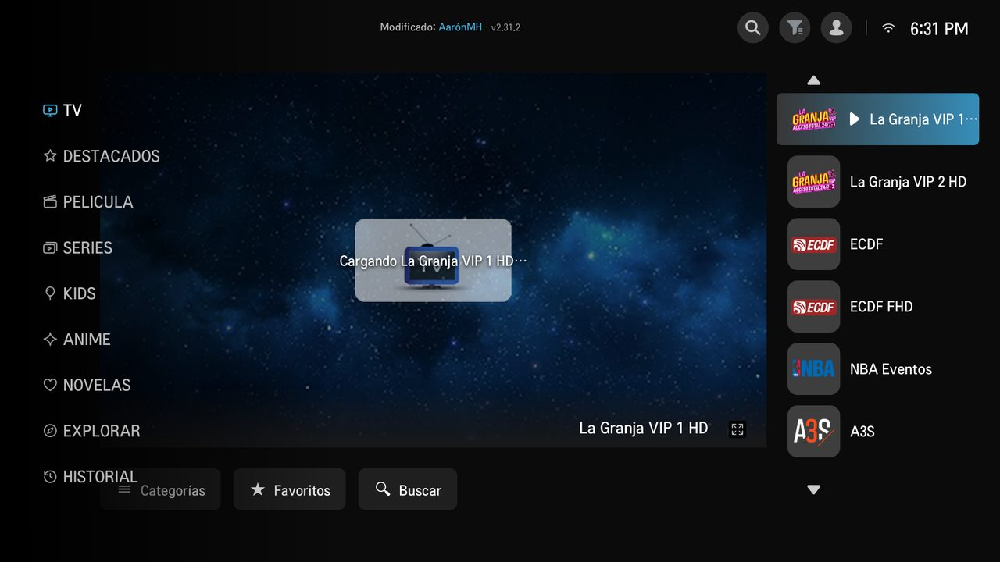
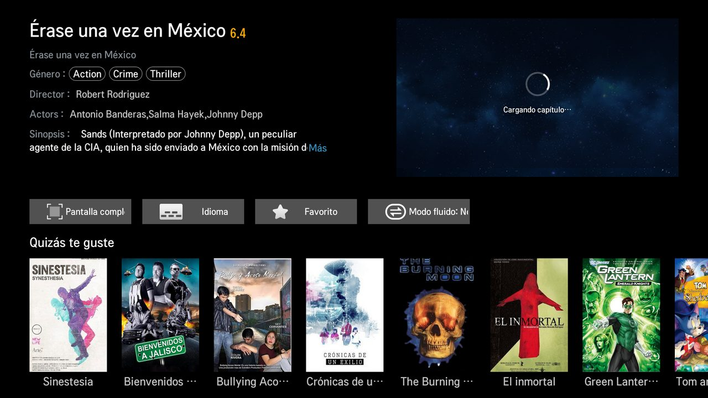
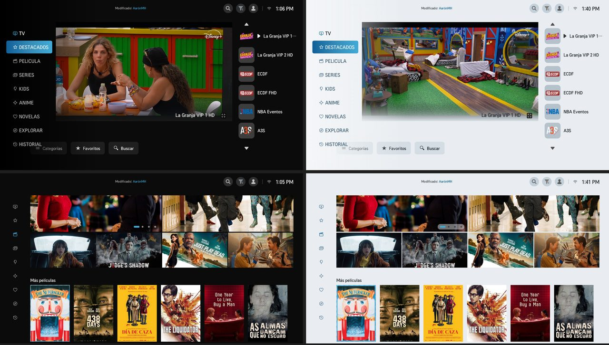
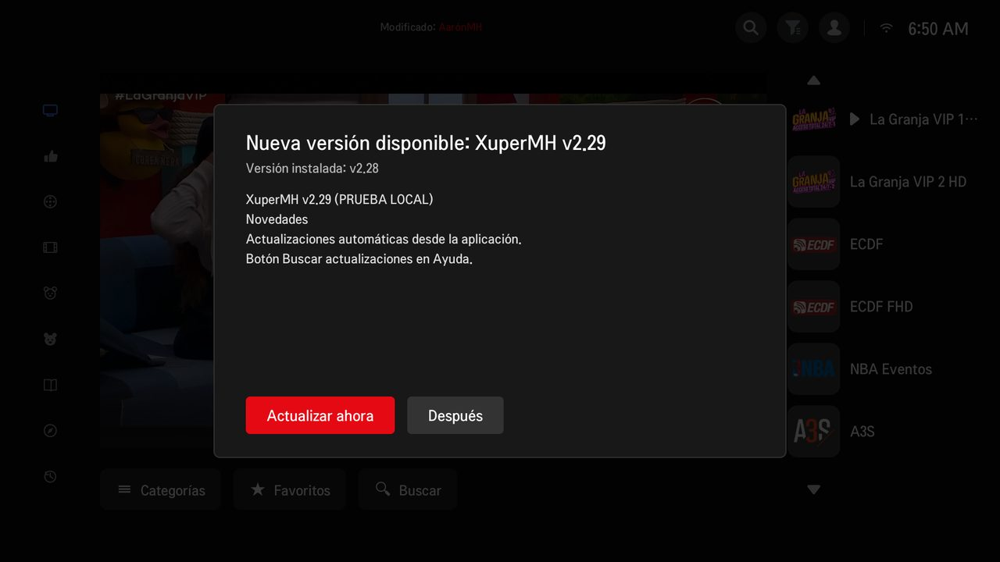

  

<h1 align="center">XuperMH</h1>

  Versión mejorada de XuperTV para televisores <b>LG webOS</b>, por <b>AarónMH</b>.

  
  
  

  <a href="TUTORIAL.md"><b>📺 Cómo instalarla (paso a paso)</b></a> ·
  <a href="https://github.com/xuperaaronmh/xupermh/releases/latest"><b>⬇️ Descargar</b></a> ·
  <a href="#reportar-un-problema"><b>🩺 Reportar un problema</b></a>

---

## Así se ve

  
  

  
   Tema oscuro y tema claro

## Qué trae

- 📡 **Canales en vivo**, películas, series, kids, anime y novelas, con favoritos e historial.
- ⚡ **Rápida y sin congelarse**: varios servidores de respaldo; si uno falla, cambia solo en segundos.
- 🎞️ **Modo fluido** para TV antiguos que no reproducen ciertos videos.
- 🌗 **Tema oscuro y tema claro.**
- 🩺 **Diagnóstico** dentro de la app: ficha del TV, servidores, H.265, reloj, memoria y reproductor.
- 🔄 **Se actualiza sola**, con descargas **firmadas digitalmente**: el TV solo acepta archivos originales.
- 🔢 La **versión aparece en la pantalla de inicio**, para que sea fácil reportar.

## Instalación

Se hace **una sola vez** y hay dos caminos:

| | Camino | Qué necesitas |
|---|---|---|
| 📱 | **Celular Android** con Termux | El celular en el mismo Wi-Fi que el TV |
| 💻 | **PC con Windows 10/11** | La PC en el mismo Wi-Fi que el TV |

👉 **[Ver el tutorial completo con imágenes](TUTORIAL.md)**

Después de instalarla, XuperMH avisa cuando hay una versión nueva y se actualiza desde el mismo TV.

  

## Televisores compatibles

TV LG con **webOS** que tengan la app **Developer Mode** de LG. Probada en webOS 1 a 6. Los TV más viejos pueden necesitar el **Modo fluido** para algunos videos.

## Reportar un problema

1. Toma una **foto de la pantalla de inicio**: ahí sale la versión.
2. Abre **Configuración → Diagnóstico**, pulsa **Analizar de nuevo** y toma otra foto.
3. Mándalas a **xuperaaronmh@gmail.com** con el modelo de tu TV y qué pasó.

---

XuperMH es un proyecto independiente. No está afiliado a LG Electronics. "LG" y "webOS" son marcas de sus respectivos dueños.
