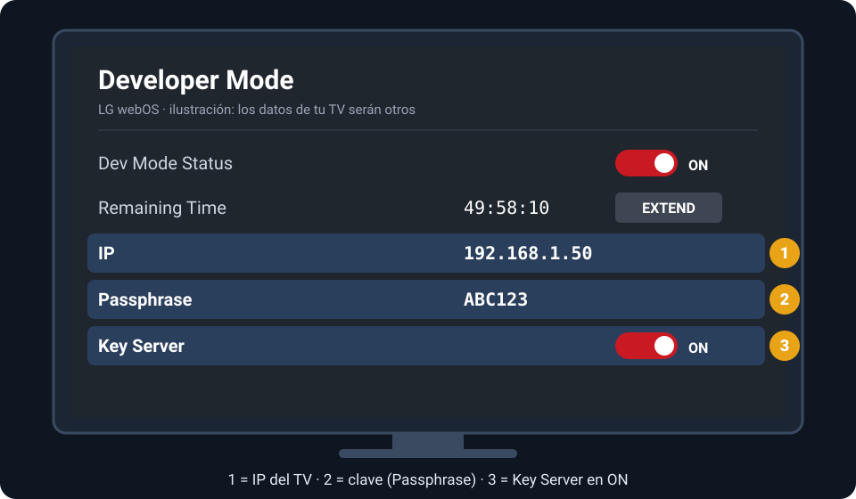
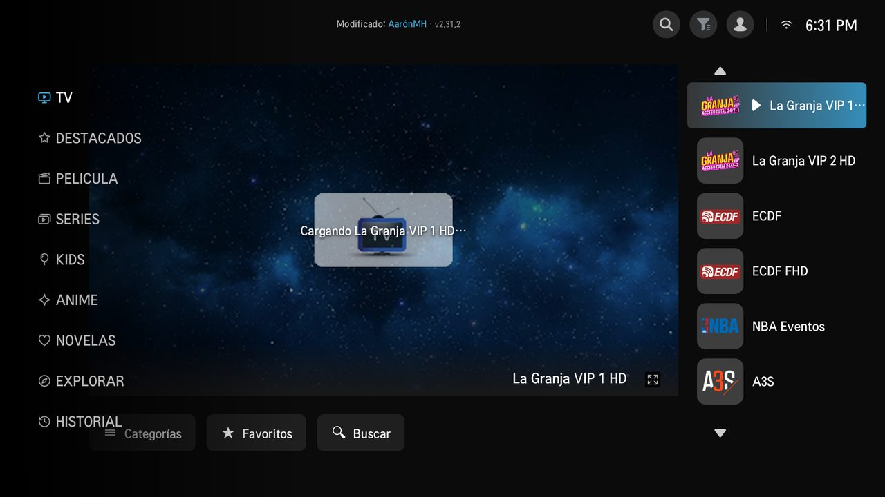
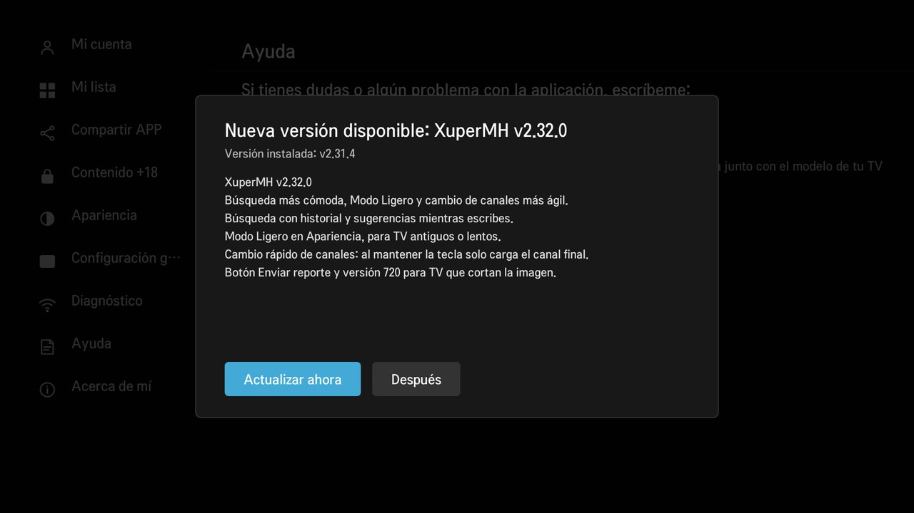

# Cómo instalar XuperMH en tu TV LG

Guía paso a paso. Se hace **una sola vez**: después XuperMH se actualiza sola desde el TV.

**Lo que necesitas**

- Un TV **LG con webOS** conectado a internet.
- Un **celular Android** o una **computadora con Windows 10/11**, en el **mismo Wi-Fi** que el TV.
- Una **cuenta LG** (es gratis; se crea desde el TV).
- Unos 15 minutos.

> iPhone no sirve para instalar: Apple no permite este tipo de herramienta. Usa un Android o una PC.

---

## Paso 1 · Activar el Modo Desarrollador en el TV

Es una opción oficial de LG para instalar apps propias. El TV se reinicia una vez.

1. En el TV abre **LG Content Store** (la tienda de apps).
2. Busca **Developer Mode**, instálala y ábrela.
3. Inicia sesión con tu cuenta LG. Si no tienes una, créala ahí mismo.
4. Activa **Dev Mode Status**. El TV se reinicia.
5. Vuelve a abrir **Developer Mode** y deja también **Key Server** en **ON**.
6. Anota los dos datos que muestra la pantalla:
   - la **IP** (por ejemplo `192.168.1.50`);
   - la **Passphrase**: una clave de 6 caracteres. Las mayúsculas y minúsculas cuentan.



> Deja esa pantalla abierta mientras instalas.

---

## Paso 2 · Instalar XuperMH (elige un camino)

### Camino A · Desde el celular Android

1. Instala **Termux**. Recomendado: desde [F-Droid](https://f-droid.org/packages/com.termux/) o desde [GitHub](https://github.com/termux/termux-app/releases). La versión de Play Store puede fallar.
2. Abre Termux y pega este comando. Descarga el instalador:

   ```bash
   curl -LO https://raw.githubusercontent.com/xuperaaronmh/xupermh/main/instalar-termux.sh
   ```

3. Pega este otro para ejecutarlo:

   ```bash
   bash instalar-termux.sh
   ```

4. Escribe la **IP** y la **Passphrase** que muestra el TV. El resto lo hace solo:
   - descarga la última XuperMH;
   - **comprueba que es el archivo original** (firma digital);
   - la sube al TV, la instala y la abre.

   La primera vez Termux instala unos programas que necesita. Contesta **Y** si te pregunta algo.

Así se ve cuando termina bien:

```text
[1/6] Revisando los programas del celular
   ✓ Todo listo
[2/6] Buscando el televisor
   ✓ TV encontrado en 192.168.1.50
[3/6] Abriendo la llave del televisor
   ✓ Llave lista (solo se usa durante esta instalación)
   ✓ Conectado al TV
[4/6] Descargando XuperMH
   ✓ XuperMH v2.31.2 descargada y firma comprobada
[5/6] Subiendo al televisor
   ✓ Copiado al TV
[6/6] Instalando en el televisor
   ✓ XuperMH v2.31.2 instalada

  ¡Listo! XuperMH se está abriendo en el TV.
```

La próxima vez que lo necesites, basta con abrir Termux y escribir `bash instalar-termux.sh`.

### Camino B · Desde una PC con Windows

1. Descarga dos archivos:
   - **[⬇️ XuperMH-Instalador-PC.zip](https://github.com/xuperaaronmh/xupermh/releases/latest/download/XuperMH-Instalador-PC.zip)**: el instalador. Se descarga con un clic.
   - **`XuperMH-vX.X.X.ipk`** (la app): entra a la **[última versión](https://github.com/xuperaaronmh/xupermh/releases/latest)**, baja hasta **Assets** y haz clic en el archivo que termina en `.ipk`. No bajes el `.sig`.
2. Haz clic derecho sobre el ZIP → **Extraer todo…**. No lo abras desde dentro del ZIP.
3. Mueve el archivo `.ipk` **a la misma carpeta** que extrajiste.
4. Haz doble clic en **`INSTALAR-XUPERMH.bat`**.
5. Escribe la **IP** y la **Passphrase** del TV cuando las pida, y espera a que diga **Fin**.

> Si Windows muestra "Windows protegió su PC", pulsa **Más información → Ejecutar de todas formas**.

### Camino C · App "XuperMH Instalador" para Android

*En preparación.* Será una app con un solo botón: escribes la clave y listo. Cuando salga, aparecerá en esta guía.

---

## Paso 3 · Listo: abre XuperMH

XuperMH aparece entre las apps del TV. En la pantalla de inicio verás la versión junto a "Modificado: AarónMH". Si mandas un reporte, toma una foto de esa pantalla.



---

## Después de instalar

### Se actualiza sola

Cuando salga una versión nueva, el TV muestra un aviso. Pulsa **Actualizar ahora** y después **apaga y enciende el TV**.



### El Modo Desarrollador dura 50 horas

LG apaga el Modo Desarrollador si no se renueva. **Si se vence, el TV borra XuperMH.**

- De vez en cuando abre **Developer Mode** en el TV y pulsa **EXTEND**: vuelve a 50 horas.
- Si ya se borró, repite el **Paso 2**.

---

## Si algo falla

| Mensaje | Qué hacer |
|---|---|
| "El TV no responde en el puerto 9922" | Revisa que el TV esté encendido, en el mismo Wi-Fi, que la IP sea la de Developer Mode y que **Dev Mode Status** esté en ON. |
| "El TV no comparte su llave" | En Developer Mode activa **Key Server**. |
| "La clave no es correcta" | Escríbela igual que en el TV. Si sigue fallando, cierra y abre Developer Mode: a veces cambia. |
| "La FIRMA NO COINCIDE" | El archivo no es el original. No lo instales y descárgalo otra vez desde esta página. |
| "El TV tiene una versión más nueva" | Desinstala XuperMH del TV y vuelve a instalar. |
| La app se borró sola | Se venció el Modo Desarrollador. Repite el Paso 2 y pulsa **EXTEND** de vez en cuando. |
| El video se queda negro o en "Conectando…" | En la película, activa **Modo fluido**. Si sigue, abre **Configuración → Diagnóstico**, toma una foto y mándala. |

¿Sigue sin funcionar? Escribe a **xuperaaronmh@gmail.com** con:
- una foto de la pantalla del error;
- el modelo de tu TV.
