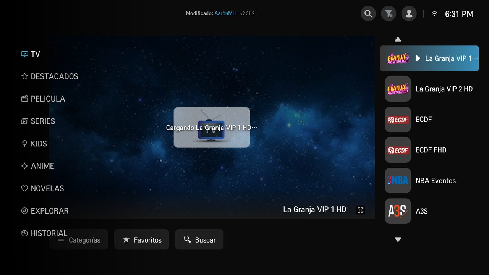

## XuperMH vX.Y.Z
Resumen en una frase de lo más importante de esta versión.
- Novedad principal, en palabras simples.
- Mejora: …
- Arreglado: …
- (máximo 4 líneas aquí: el aviso del TV muestra solo las 6 primeras)

  

### Detalle
- 🆕 **Novedad principal**: explicación más larga si hace falta.
- ⚡ **Mejora**: …
- 🐛 **Arreglado**: …

### Cómo actualizar
- **Ya tienes XuperMH (v2.31.1 o posterior):** te llega sola. Pulsa **Actualizar ahora** en el aviso y luego **apaga y enciende el TV**.
- **Primera vez o versión más vieja:** sigue el **[tutorial de instalación](https://github.com/xuperaaronmh/xupermh/blob/main/TUTORIAL.md)** (celular Android o PC).

### Archivos
| Archivo | Para qué |
|---|---|
| `XuperMH-vX.Y.Z.ipk` | La app para el TV |
| `XuperMH-vX.Y.Z.ipk.sig` | Firma digital (la usan el TV y los instaladores; no hace falta abrirla) |
| `XuperMH-Instalador-PC.zip` | Instalador para Windows |

¿Problemas? Manda una foto de la pantalla de inicio (sale la versión) y otra del **Diagnóstico** a **xuperaaronmh@gmail.com**.

<!--
  REGLAS DE ESTA PLANTILLA
  1. Las 6 primeras líneas con texto son las que muestra el aviso de
     actualización en el TV (xUpdNotes en app.js): solo texto, sin HTML ni
     imágenes, y sin emojis (los TV viejos no los dibujan).
  2. Las imágenes van después, con la URL "raw" del repo.
     Capturas nuevas: docs/img/vX.Y.Z-algo.jpg, 1280 px, JPG.
  3. Este comentario se puede dejar: GitHub no lo muestra y el TV no llega a leerlo.
-->
